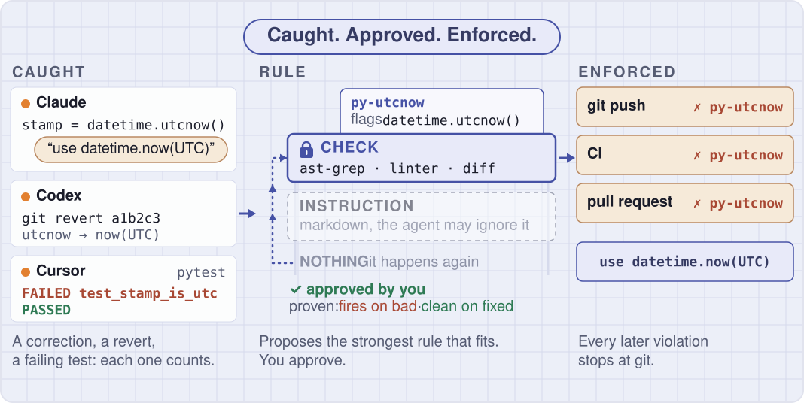

# oncebitten

**oncebitten turns repeated agent mistakes into rules that git enforces.** When the same mistake shows up in two sessions, or you state a rule once, it proposes a check. You approve it, and the check then runs at pre-push and in CI.

<p align="center">
<picture>
<source media="(prefers-color-scheme: dark)" srcset="docs/media/oncebitten-dark.svg" />

</picture>
</p>

Status: pre-alpha. Capture, evidence clustering, `check`, `replay` and the gate work; triage and rule proposals are in progress ([PLAN.md](PLAN.md)).

## Install

Agent plugin (capture hooks; nothing to build):

| Host | Install |
| --- | --- |
| Claude Code | `/plugin marketplace add bcmyguest/oncebitten` then `/plugin install oncebitten@oncebitten` |
| Codex | `codex plugin marketplace add bcmyguest/oncebitten`, then install `oncebitten` from `/plugins` |
| Copilot CLI | `copilot plugin marketplace add bcmyguest/oncebitten` then `copilot plugin install oncebitten@oncebitten` |
| Cursor | Import `https://github.com/bcmyguest/oncebitten` as a team marketplace (Dashboard, Settings, Plugins) |
| pi | `pi install git:github.com/bcmyguest/oncebitten` |
| opencode | Command line install below, then `oncebitten hooks install --host opencode --scope user` |

Each plugin downloads the release binary for its version on first use and checks its SHA-256.

Command line, for the gate and `evidence`:

```sh
curl -fsSL https://raw.githubusercontent.com/bcmyguest/oncebitten/main/install.sh | sh     # macOS, Linux
irm https://raw.githubusercontent.com/bcmyguest/oncebitten/main/install.ps1 | iex          # Windows PowerShell
```

Both verify the release's SHA-256 before installing. Other hosts, pinning and building from source: [docs/install.md](docs/install.md).

## Usage

```sh
oncebitten config show            # merged configuration as TOML
oncebitten config show --origin   # annotate each value with its layer
oncebitten config path            # configuration files it reads
oncebitten check                  # run active rules against changes since HEAD
oncebitten replay <rule-id>       # prove a rule in an OpenShell sandbox; writes proof.json
oncebitten gate pr --base origin/main   # CI gate: new violations of active block rules
oncebitten baseline update        # accept today's violations in .oncebitten/baseline.json
oncebitten hooks install --host claude --scope user   # also codex, cursor, copilot, opencode, pi
oncebitten hooks uninstall --host claude --scope user
oncebitten evidence list          # mistake clusters seen in 2+ sessions, or stated once
oncebitten evidence reject <id> --reason "one-off"
```

Rules: [docs/rules.md](docs/rules.md). Example rules: [examples/](examples/README.md). Gate, proofs and baseline: [docs/gate.md](docs/gate.md). Agent-facing summary: [llms.txt](llms.txt).

Hooks record prompts and tool outcomes locally: [docs/capture.md](docs/capture.md) lists what each host reports and how each was verified. [docs/evidence.md](docs/evidence.md) covers clustering and rejections.

Settings and their precedence: [docs/configuration.md](docs/configuration.md).

## Gate

```yaml
# .pre-commit-config.yaml
repos:
  - repo: https://github.com/bcmyguest/oncebitten
    rev: <commit or tag>
    hooks:
      - id: oncebitten-gate          # builds from source; or oncebitten-gate-system to use the installed binary
```

```sh
pre-commit install --hook-type pre-push
oncebitten rules sync             # writes .oncebitten/rules.lock; commit it
```

The gate needs [pre-commit](https://pre-commit.com) 3.2.0 or later. CI templates for GitHub Actions, GitLab CI and Azure Pipelines: [templates/](templates/). In CI, run `oncebitten rules sync --frozen` before the gate.

## Development

Build and test with `cargo test`; CI also runs `cargo fmt --check` and `cargo clippy --all-targets -- -D warnings` on Linux, macOS and Windows. The build order and open steps live in [PLAN.md](PLAN.md).

## License

Apache-2.0. See [LICENSE](LICENSE).
