# Proposals

Triage turns an evidence cluster into a queued result (see [triage.md](triage.md)). A verdict that names a rule-shaped mistake carries a drafted rule; oncebitten writes the draft as a proposed rule, replays it, and queues it for review. Proposals never become active by themselves.

## From cluster to proposal

<p align="center">
<picture>
<source media="(prefers-color-scheme: dark)" srcset="media/proposals-flow-dark.svg" />

</picture>
</p>

- A verdict is rule-shaped when `repeatable` is true, `proposed_fix_kind` is not `none` and `generality` is not `one-off`. A draft beside any other verdict is dropped; the verdict queues as a finding.
- An invalid draft rejects the whole answer as "could not run": nothing is printed or written.
- The draft lands in the repo's project layer, `.oncebitten/rules/<id>/`, the repo being the git root of the triage working directory. A draft whose id matches a loaded rule, or that breaks the rule set, is not written.
- Replay runs as `oncebitten replay` does: a proven verdict writes `proof.json`. Without a sandbox, or when replay rejects the rule or cannot run, the proposal stays unproven and its reason is kept. When `openshell` is not on `PATH`, `oncebitten triage <id>` adds one stderr line saying so; see [doctor.md](doctor.md).
- A cluster queues at most once. A rejected cluster is never queued.

## Draft

The draft is the optional `draft` key of the triage answer, `null` when no rule fits.

| Field | Meaning |
|---|---|
| `id` | lowercase kebab-case, at most 64 characters; the rule directory name |
| `description`, `rationale` | 1 to 1000 characters |
| `mode` | `block` or `steer` |
| `engine` | `ast-grep`, `diff`, `native` or `steer` |
| `language` | optional |
| `check` | ast-grep only: the `check.yml` text |
| `command`, `fired_exit_codes`, `fired_output_contains` | native only |
| `when_changed`, `require_changed` | diff only, non-empty glob arrays |
| `bad`, `fixed` | `{name, content}`; named `bad.<ext>` and `fixed.<ext>` (diff: `.diff`), at most 64 KiB each |
| `corpus` | up to 10 `{name, content}` files the check must pass; replay needs at least one |

Validation is as strict as for a hand-written rule: the written `rule.toml` must load, `check.yml` must compile, globs must parse, and file names must be plain names that Windows can also write (no `<>:"|?*` or control characters, no trailing dot or space, no reserved device names such as `nul`, `con` or `com1`). A write that fails midway removes the rule directory. Keys for another engine are rejected.

### Steer drafts

A draft with `engine = "steer"` must have `mode = "steer"`. The reverse is not refused: a steer-mode draft with another engine still parses. Its fixtures come from the cluster's evidence, not the model:

- `bad` is the cluster's latest recorded command, as a `{"event": "tool", "tool", "command"}` event.
- A user-correction cluster's evidence is a prompt, not a command. Its `bad` is the latest command in the corrected turns (see [triage.md](triage.md#call-contract)) that the model's own `bad` command matches once turned into the trigger below. With no such command nothing is written and triage warns `not queued`.
- The trigger is `bad`'s tool plus a regex on its program, its first subcommand (a word before any flag) and its first flag, so `git push --force origin main` also fires on `git -C repo push origin dev --force` but not on `git push origin main` or `git push --force-with-lease`. Leading `NAME=value` assignments and a path on the program are ignored.
- The corpus is up to 5 other successful commands from the same repo in the store. Repo paths compare in canonical form, so a Windows `\\?\` prefix or a macOS `/private` symlink still matches. With none, the model's corpus is kept.
- A steer draft is proven when it is queued, with the matcher in the running binary. It needs no OpenShell sandbox; every other engine does.
- A steer draft is exempt from the rule that `bad` must quote the changed code sent to triage: its fixtures are recorded events.
- Every steer draft writes `action = "inform"`. The draft has no `action` key, so a model request for `deny` fails to parse. Use `accept --deny` to upgrade.

## Commands

```
oncebitten proposals list
oncebitten proposals show <cluster-id>
oncebitten proposals accept <cluster-id> [--deny]
oncebitten proposals reject <cluster-id> --reason <text>
oncebitten proposals reject <cluster-id> --duplicate-of <other-cluster-id>
```

Proposals are keyed by their evidence cluster id.

- `list` prints `cluster  state  kind  rule  proof  hits  repo` per queued result. State is `waiting`, `accepted` or `rejected`; kind is `proposal` or `finding`; proof is `proven`, `unproven` or `-`; hits is `N hits in M files` or `-`.
- `show` adds the rule directory, the hits with up to three sample lines (`path:line: text`), rationale, proof note, verdict JSON and the occurrence event ids that produced it. After a decision it prints the kept counts instead, because the events are gone.
- `accept` flips `status = "proposed"` to `status = "active"` only when the rule has a valid proof. Otherwise it exits 2 with the reason: no proof, a stale proof, or a finding. Commit the rule directory with its `proof.json`. On activation, `accept` also writes, in the proposal's own repo whatever the cwd, one `.oncebitten/baseline.json` entry per existing hit of that rule, and keeps the entries of other rules. Later commits that touch those lines pass the gate; a new hit fails it.
- `accept --deny` sets a steer proposal's `[steer]` action to `deny`, re-proves it with the running binary, then activates it. It exits 2 for a non-steer proposal.
- `reject` records the rejection in the evidence store (as `evidence reject` does) and removes the rule directory if it is still proposed. The cluster is never proposed again.
- `reject --duplicate-of <other>` rejects the cluster as a duplicate of `<other>`, which must be a queued or rejected proposal other than the cluster itself. It rejects the cluster with the reason `duplicate of <other>`, then stores the link in the `duplicate_of` column; a failed reject stores no link. It never merges or drops another proposal.
- `accept` and `reject` delete the cluster's captured events and keep one provenance record: outcome, rule, reason, occurrence and session counts, first and last seen, decision time. The `rejections` table, not the events, keeps a rejected cluster from returning.

Exit 0 on success, 2 on any error.

## Possible duplicates

When a proposal is recorded, it is compared with every row in the `proposals` table except itself, whatever its state. Two checks run, and the first match wins:

1. Equal `mistake_class` (reason `same mistake_class`). Triage shows the host the classes already named, so the same mistake reuses one slug; see [triage.md](triage.md).
2. Text similarity of the rationale at or above 0.5 by normalised token Jaccard (reason `similar text`). Tokens are lowercase alphanumeric runs. The score is `|A ∩ B| / |A ∪ B|`. "never use unwrap in library code" and "stop using unwrap in library code" score 0.5 and match. "never use unwrap in code" and "never run clippy in code" score 0.43 and do not.

A match is shown as `possible duplicate of <id> (<reason>)` in `proposals list`, `proposals show`, and the forge PR body. The match is advisory. Nothing merges or drops automatically. Confirm a duplicate with `proposals reject <id> --duplicate-of <other>`, which shows as `confirmed duplicate of <other>`.

## Gate notice

`gate pre-push` and `gate pr` print one line to stderr when proposals wait for the current repo:

```
2 rule proposals waiting: oncebitten proposals list
```

The notice never changes the gate's exit code, and the gate never creates the evidence store.

## Background triage

When `capture` records an event that brings a cluster to its threshold (see [evidence.md](evidence.md)), it starts `oncebitten triage <id> --queue` detached in the event's repo and returns at once. The capturing host is asked when it has a configured target; otherwise the `triage.default` target. Background triage:

- takes a per-cluster lock in the store, so one triage per cluster runs; a lock older than 30 minutes is taken over;
- skips a cluster that is already queued or rejected without asking the host;
- prints nothing and uses the triage timeout (120 seconds per host call);
- stores the error of a failed run, which `oncebitten proposals list` prints to stderr as `triage failed for <id> (<host>): <error>; retry: oncebitten triage <id>` until a later run of that cluster or a queued proposal replaces it.

Capture ignores events outside a git repository for this purpose and never fails the host's hook because of triage. Set `triage.background = false` to turn it off (see [configuration.md](configuration.md)).

## Store

Two tables in the evidence database, created on open: `proposals` (one row per cluster: repo, kind, state, rule id and directory, proof flag and note, verdict JSON, rationale, occurrence ids, and after delivery the target, commit and PR URL) and `triage_locks`.

## Existing hits

When a proposal is recorded, its rule runs over the tracked files as they are on disk. The count is stored as `N hits in M files` with up to three sample lines. It informs reviewers and never blocks.

- Only `ast-grep` rules are counted. Native rules and diff rules show `-`.
- A scan that fails leaves the proposal queued with no hits.
- `list` shows the count; `show` shows the count and samples. The delivered PR body adds `Hits:` and the line `existing hits will be baselined`, which `accept` makes true in the proposal's own repo. A `rules-repo` PR qualifies the line: only the proposal's repo is baselined, and other repos using the rule get no baseline.

## Delivery

`oncebitten proposals deliver <cluster-id> [--to pr|rules-repo] [--push]` commits a proposed rule. It never sets the rule's status; `proposals accept` does.

<p align="center">
<picture>
<source media="(prefers-color-scheme: dark)" srcset="media/proposals-delivery-dark.svg" />

</picture>
</p>

- A stale or missing proof replays first, with the prover `triage` uses. A rule that stays unproven is still delivered; the commit message and PR body say `unproven: <reason>`.
- `pr` commits only the rule directory, with the message `chore(oncebitten): propose rule <id>` and a body that lists the cluster id, the rationale and the proof state. Nothing to commit exits 2. `--push` runs `git push` to the branch's upstream.
- `rules-repo` needs the one source with `writable = true` (`rules.sources[].writable`) and that source cloned by `rules sync`. It copies the rule directory into the clone, creates `oncebitten/propose-<id>` there and commits. The clone stays on that branch until the next `rules sync`. With `--push` it pushes the branch and opens a PR against the source's `rev`, or origin's default branch; without it prints the branch and the push command.
- The forge is chosen as in [configuration.md](configuration.md) (`forge` key, else the `origin` remote). A forge CLI that is missing or exits non-zero is an error that carries its stderr.
- The store records the target, commit and PR URL; `proposals list` and `proposals show` print them. Older databases gain the three columns on open.
- The `Hits:` line and `existing hits will be baselined` line appear in the PR body when the proposal has hits. For `rules-repo` the line says that only the proposal's repo is baselined, by `oncebitten proposals accept <id>`.
- Exit 0 delivered; 2 a finding, a rejected proposal, no target, or any failure.
