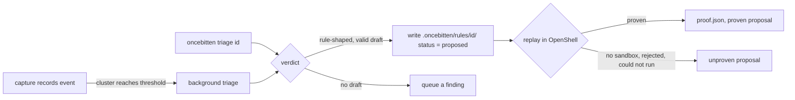

# Proposals

Triage turns an evidence cluster into a queued result (see [triage.md](triage.md)). A verdict that names a rule-shaped mistake carries a drafted rule; oncebitten writes the draft as a proposed rule, replays it, and queues it for review. Proposals never become active by themselves.

## From cluster to proposal



- A verdict is rule-shaped when `repeatable` is true, `proposed_fix_kind` is not `none` and `generality` is not `one-off`. A draft beside any other verdict is dropped; the verdict queues as a finding.
- An invalid draft rejects the whole answer as "could not run": nothing is printed or written.
- The draft lands in the repo's project layer, `.oncebitten/rules/<id>/`, the repo being the git root of the triage working directory. A draft whose id matches a loaded rule, or that breaks the rule set, is not written.
- Replay runs as `oncebitten replay` does: a proven verdict writes `proof.json`. Without a sandbox, or when replay rejects the rule or cannot run, the proposal stays unproven and its reason is kept.
- A cluster queues at most once. A rejected cluster is never queued.

## Draft

The draft is the optional `draft` key of the triage answer, `null` when no rule fits.

| Field | Meaning |
|---|---|
| `id` | lowercase kebab-case, at most 64 characters; the rule directory name |
| `description`, `rationale` | 1 to 1000 characters |
| `mode` | `block` or `steer` |
| `engine` | `ast-grep`, `diff` or `native` |
| `language` | optional |
| `check` | ast-grep only: the `check.yml` text |
| `command`, `fired_exit_codes`, `fired_output_contains` | native only |
| `when_changed`, `require_changed` | diff only, non-empty glob arrays |
| `bad`, `fixed` | `{name, content}`; named `bad.<ext>` and `fixed.<ext>` (diff: `.diff`), at most 64 KiB each |
| `corpus` | up to 10 `{name, content}` files the check must pass; replay needs at least one |

Validation is as strict as for a hand-written rule: the written `rule.toml` must load, `check.yml` must compile, globs must parse, and file names must be plain names. Keys for another engine are rejected.

## Commands

```
oncebitten proposals list
oncebitten proposals show <cluster-id>
oncebitten proposals accept <cluster-id>
oncebitten proposals reject <cluster-id> --reason <text>
```

Proposals are keyed by their evidence cluster id.

- `list` prints `cluster  state  kind  rule  proof  repo` per queued result. State is `waiting`, `accepted` or `rejected`; kind is `proposal` or `finding`; proof is `proven`, `unproven` or `-`.
- `show` adds the rule directory, rationale, proof note, verdict JSON and the occurrence event ids that produced it.
- `accept` flips `status = "proposed"` to `status = "active"` only when the rule has a valid proof. Otherwise it exits 2 with the reason: no proof, a stale proof, or a finding. Commit the rule directory with its `proof.json`.
- `reject` records the rejection in the evidence store (as `evidence reject` does) and removes the rule directory if it is still proposed. The cluster is never proposed again.

Exit 0 on success, 2 on any error.

## Gate notice

`gate pre-push` and `gate pr` print one line to stderr when proposals wait for the current repo:

```
2 rule proposals waiting: oncebitten proposals list
```

The notice never changes the gate's exit code, and the gate never creates the evidence store.

## Background triage

When `capture` records an event that brings a cluster to its threshold (see [evidence.md](evidence.md)), it starts `oncebitten triage <id> --queue` detached in the event's repo and returns at once. The capturing host is asked when it has a configured target; otherwise the `triage.default` target. Background triage:

- takes a per-cluster lock in the store, so one triage per cluster runs; a lock older than 30 minutes is taken over;
- skips a cluster that is already queued or rejected without asking the host;
- prints nothing and uses the triage timeout (120 seconds per host call).

Capture ignores events outside a git repository for this purpose and never fails the host's hook because of triage. Set `triage.background = false` to turn it off (see [configuration.md](configuration.md)).

## Store

Two tables in the evidence database, created on open: `proposals` (one row per cluster: repo, kind, state, rule id and directory, proof flag and note, verdict JSON, rationale, occurrence ids) and `triage_locks`.

## Not yet

Delivery as a commit in the current pull request or as a pull request to the rules repository (gh, glab, az), and replay of stale proofs, are step 9b.
